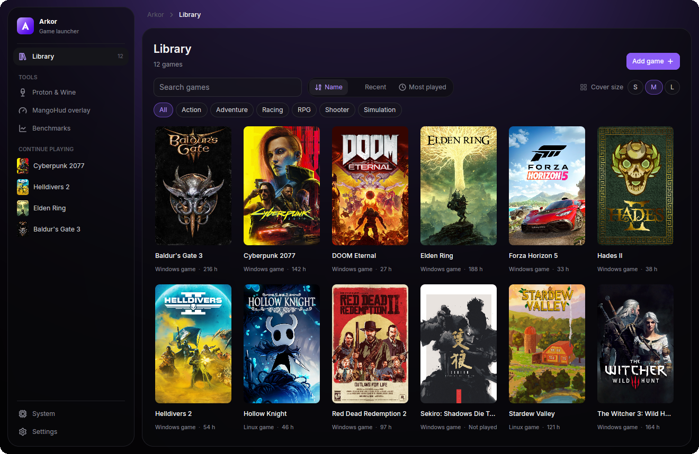

<p align="center">
  
</p>

<p align="center">
  <a href="https://github.com/WinTone01/arkor/releases/latest"></a>
  <a href="LICENSE"></a>
  
  
  
</p>

<p align="center">
  <b>Arkor</b> is a fast, native game launcher for Linux. Steam, Epic, GOG, Amazon and your
  own Windows and Linux games in one library, started with the right Proton, each with its
  own MangoHud, Gamescope, frame generation and upscaler settings — no config files to edit,
  and a console mode that needs nothing but a gamepad.
</p>

<p align="center">
  <a href="#install"><b>Install</b></a> ·
  <a href="#uninstall"><b>Uninstall</b></a> ·
  <a href="#screenshots"><b>Screenshots</b></a> ·
  <a href="#features"><b>Features</b></a> ·
  <a href="#first-steps"><b>First steps</b></a> ·
  <a href="#command-line"><b>Command line</b></a> ·
  <a href="#files"><b>Files</b></a>
</p>

<br>

<p align="center">
  
</p>

<table>
  <tr>
    <td width="25%" align="center" valign="top">
      <br>
      <b>One library</b><br>
      <sub>Steam, Heroic, Lutris, Faugus and your own games together</sub>
    </td>
    <td width="25%" align="center" valign="top">
      <br>
      <b>Proton on autopilot</b><br>
      <sub>Always-newest builds, runtimes and anti-cheat installed for you</sub>
    </td>
    <td width="25%" align="center" valign="top">
      <br>
      <b>More frames</b><br>
      <sub>lsfg-vk, MAKO, OptiScaler and Gamescope, per game</sub>
    </td>
    <td width="25%" align="center" valign="top">
      <br>
      <b>Steam built in</b><br>
      <sub>Proton and Arkor's settings written into Steam for you</sub>
    </td>
  </tr>
</table>

<a id="install"></a>

##  Install

> [!TIP]
> **Arch Linux, CachyOS, EndeavourOS, Manjaro and other up-to-date distributions (x86_64,
> glibc 2.44 or newer)** — paste this into a terminal:
>
> ```bash
> curl -fsSL https://raw.githubusercontent.com/WinTone01/arkor/master/packaging/install.sh | bash
> ```
>
> It downloads the latest release from [Releases](https://github.com/WinTone01/arkor/releases)
> (no build, no root) and installs it into `~/.local` with its app-menu entry and icon.
> Arkor then updates itself: **Settings → General → Arkor updates** (in console mode
> **Settings → Arkor update**), or the note in the
> sidebar when a new version is out.

On the first start Arkor sets itself up: it downloads umu-launcher, the Steam Linux Runtime,
the EasyAntiCheat and BattlEye runtimes and, if you have no Proton yet, Proton-CachyOS.

<details>
<summary><b>Build from source</b> (an Arch package, or distributions with an older glibc)</summary>

<br>

On Arch-based systems this builds Arkor as a pacman package (`arkor-git`); update it by running
the command again (a package-manager install does not update itself):

```bash
git clone https://github.com/WinTone01/arkor.git /tmp/arkor && cd /tmp/arkor/packaging/arch && makepkg -si
```

On other distributions, install Rust from [rustup.rs](https://rustup.rs) or your package manager, then:

```bash
git clone https://github.com/WinTone01/arkor.git && cd arkor
cargo build --release -p arkor -p arkor-login
./target/release/arkor
```

The window needs Vulkan and `libxkbcommon`, `libxcb`, `wayland`, `fontconfig`; the store login window
needs `webkit2gtk-4.1` (without it, logins open in your browser). At run time Arkor uses `curl`,
`tar` and `python` (for umu-run).

</details>

**Optional tools** — Arkor works with what you have, and **Downloads → System tools** installs
what is missing with one click: `mangohud`, `gamescope`, `winetricks`, `steam`, `vkbasalt`.

<a id="uninstall"></a>

##  Uninstall

> [!NOTE]
> **Installed with the command above** — paste this into a terminal:
>
> ```bash
> curl -fsSL https://raw.githubusercontent.com/WinTone01/arkor/master/packaging/install.sh | bash -s -- --uninstall
> ```
>
> It removes the program, its app-menu entry and its icon. Your games, Wine prefixes and
> settings in `~/.config/arkor` stay, so installing again picks up where you left off.
> Installed as a pacman package instead? Remove it with `sudo pacman -R arkor-git`.

<a id="screenshots"></a>

##  Screenshots

<table>
  <tr>
    <td width="50%"><br><sub><b>A game's page</b> — quick switches and how it starts</sub></td>
    <td width="50%"><br><sub><b>Compatibility</b> — always-newest Proton builds and one-click switches</sub></td>
  </tr>
  <tr>
    <td width="50%"><br><sub><b>MangoHud editor</b> — live preview, presets and tabs</sub></td>
    <td width="50%"><br><sub><b>Game defaults</b> — one Proton for all, what new games start with</sub></td>
  </tr>
</table>

<sub>Cover art from <a href="https://www.steamgriddb.com">SteamGridDB</a>; the games and their art belong to their publishers.</sub>

<a id="features"></a>

##  Features

<table>
  <tr>
    <td width="50%" valign="top">
      <br>
      <b>One library</b><br>
      Finds games already installed in <b>Steam</b>, <b>Heroic</b> (Epic, GOG, sideloaded),
      <b>Lutris</b> and <b>Faugus</b>, imports games from any Wine prefix, or adds a game by
      hand. Covers from the store or picked from <b>SteamGridDB</b> (animated ones too, and
      set by themselves for new games), categories, search, hidden games and play time.
    </td>
    <td width="50%" valign="top">
      <br>
      <b>Proton that takes care of itself</b><br>
      Runs Windows games through <b>umu-launcher</b> inside the <b>Steam Linux Runtime</b>.
      Proton-CachyOS, GE-Proton, DW-Proton and Wineland come as <b>Latest</b> builds that keep
      themselves up to date, next to any fixed version you download. <b>EasyAntiCheat</b> and
      <b>BattlEye</b> are installed by Arkor itself.
    </td>
  </tr>
  <tr>
    <td valign="top">
      <br>
      <b>Steam, Epic, GOG and Amazon</b><br>
      Log in in Arkor's own login window (nothing to copy), see every game you own and
      <b>install</b> it where you want: pause and resume, updates, file checks and removal,
      single DLC, GOG's Linux versions and languages. Before installing, Arkor says how a
      game runs on Linux (<b>anti-cheat</b>, <b>ProtonDB</b>, Steam Deck). Logins stay on
      your computer, <b>encrypted</b> by systemd.
    </td>
    <td valign="top">
      <br>
      <b>Console mode</b><br>
      From boot to game with only a <b>gamepad</b>: your games, the stores and their logins,
      downloads, Proton builds, disks, settings and the power menu, full screen, with an
      on-screen keyboard wherever something is typed, sounds of its own, a start-up
      animation with your games and Arkor's own updates. <b>Wi-Fi, Bluetooth, sound, screens
      and power</b> are set there, too, and the middle button brings a <b>quick menu</b> over a
      running game. Buttons are shown as your pad marks them (Xbox, PlayStation, Nintendo).
      Games are added and arranged there, too: favourites, categories, covers.
      Steam's windows stay behind it.
      Press the pad's middle button or <kbd>F11</kbd>, or let Arkor start in it when the
      computer does.
    </td>
  </tr>
  <tr>
    <td valign="top">
      <br>
      <b>Steam games, done properly</b><br>
      Steam still starts them, and Arkor writes its choices into Steam: the game's
      <b>Proton</b> and launch options that run it <b>through Arkor</b>, so MangoHud, frame
      generation and the environment apply whether you press Play in Arkor or in Steam.
      New games go into the <b>library folder you choose</b>, a new one on another disk too.
      Optionally Arkor <b>controls Steam</b>: downloads and their order, installing, moving,
      achievements, DLC and workshop, without Steam's windows.
    </td>
    <td valign="top">
      <br>
      <b>More frames, per game</b><br>
      <b>Gamescope</b>, <b>lsfg-vk</b> (Lossless Scaling frame generation), <b>MAKO</b>,
      <b>AFMF</b>, <b>OptiScaler</b> (e.g. FSR 4 in DLSS games), <b>DLSS Enabler</b>,
      newer <b>DLSS</b> files, <b>HelixSR</b> and <b>DLSS-NR</b> for AMD cards. Only what
      your graphics card can use is shown.
    </td>
  </tr>
  <tr>
    <td valign="top">
      <br>
      <b>A real MangoHud editor</b><br>
      A live preview with presets, then layout, metrics, look, FPS limit and VSync, logging
      and key bindings in clear tabs. One shared layout for every game, or a game's own.
    </td>
    <td valign="top">
      <br>
      <b>Better pictures</b><br>
      <b>vkBasalt</b>, <b>ReShade</b>, vkSumi colour grading, HDR, and one-click Proton
      and driver switches: Wayland, NTSYNC, WOW64, Reflex, Anti-Lag 2, DLSS/FSR/XeSS upgrades.
    </td>
  </tr>
  <tr>
    <td valign="top">
      <br>
      <b>Downloads that run themselves</b><br>
      One queue with pause, resume and retry. What a game's settings need is fetched as soon
      as you switch it on; updates come daily, weekly, when a game starts or never. Missing
      system tools install from the repositories (or the AUR) with a progress bar.
    </td>
    <td valign="top">
      <br>
      <b>Everything a game needs</b><br>
      Launch options in Steam style (<code>VAR=1 %command%</code>), commands before and after,
      a second program next to the game, winecfg and winetricks, protonfixes found by name,
      clear launch logs, benchmarks from MangoHud logs, backups and Discord status.
    </td>
  </tr>
  <tr>
    <td valign="top">
      <br>
      <b>"Why did it not start?"</b><br>
      When a game does not start, Arkor looks at its log, files, prefix and settings and at
      your computer, names the reason in plain words and offers fixes that take one press:
      a missing Windows component, another Proton, a driver, a disk that is not mounted.
      A game can also be started once with a detailed log, or once without any extras.
    </td>
    <td valign="top">
      <br>
      <b>Saves that are not lost</b><br>
      <b>Cloud saves</b> of Epic and GOG games: fetched before a game starts, uploaded when it
      ends, compared by their contents. When they changed on both sides you choose, and a
      <b>copy</b> is kept before anything is put over them, to put back with one press.
      Deleting goes through a guard; prefixes go to the trash.
    </td>
  </tr>
  <tr>
    <td colspan="2" valign="top">
      <br>
      <b>Looks the way you like</b><br>
      Dark or light, any accent colour, four glass styles, animated backgrounds or your own
      picture, adjustable text size; in English and Turkish. Arkor updates itself and
      restarts in place.
    </td>
  </tr>
</table>

<a id="first-steps"></a>

##  First steps

| | |
| --- | --- |
| **1. Open Arkor** | The first start installs what games need; the sidebar shows the progress. |
| **2. Add your games** | **Library → Add game**: pick a game Arkor found on your computer, or add an `.exe` (or a Linux game) by hand. **Stores** installs your Steam, Epic, GOG and Amazon games. |
| **3. Play** | A game's page has its settings: *Overview* holds the most used switches, and every feature says in one line what it does. |
| **4. Set your defaults** | **Settings → Game defaults** sets the Proton for all games and what new games start with. |
| **Something wrong?** | A game that does not start: **Logs → Why did it not start?** on its page, or **Why?** in console mode. |

Steam games keep starting from Steam. Arkor sets their Proton and launch options in Steam
for you (**Compatibility → Steam** on the game's page), so its settings apply from either
launcher.

<a id="command-line"></a>

##  Command line

Everything in the window is also scriptable:

| Command | What it does |
| --- | --- |
| `arkor` | Opens the window (`--tray` starts in the system tray, `--console` in console mode) |
| `arkor open <page or game>` | Opens a page, e.g. `arkor open local:starfall-odyssey#overlay` |
| `arkor list` · `arkor detect` | Prints the library · games found in other launchers |
| `arkor add <exe> [--name N] [--linux]` | Adds a game by hand |
| `arkor launch <id>` | Starts a game with its settings |
| `arkor run <id> -- <command>` | Runs any command with a game's settings |
| `arkor tool <id> winecfg \| winetricks \| run <file>` | Prefix tools |
| `arkor proton installed \| list \| install` | Proton builds |
| `arkor trouble <id>` | Why a game did not start, and what helps |
| `arkor saves sync \| list \| restore <id>` | Cloud saves of Epic and GOG games, and copies of them |
| `arkor backup create \| restore <file>` | Backs up or restores Arkor's data |
| `arkor update [--check]` | Updates Arkor to the latest release |

Run `arkor help` for the full list.

**Keyboard:** <kbd>Ctrl</kbd>+<kbd>F</kbd> search · <kbd>Ctrl</kbd>+<kbd>Enter</kbd> play ·
<kbd>Ctrl</kbd>+<kbd>Tab</kbd> next section · <kbd>Esc</kbd> back ·
<kbd>F11</kbd> console mode (gamepad).

<a id="files"></a>

##  Where things are

| | |
| --- | --- |
| Settings, library, game profiles | `~/.config/arkor/` |
| Launch logs, download queue | `~/.local/state/arkor/` |
| umu-run, anti-cheat runtimes, downloaded tools, store logins (encrypted) | `~/.local/share/arkor/` |
| Copies of saves | `~/.local/share/arkor/saves/` |
| Games installed from stores | `~/Games/Arkor/Games/` (changeable in Settings) |
| Proton builds | `~/.local/share/Steam/compatibilitytools.d/` (shared with Steam and Faugus) |
| Wine prefixes of new games | `~/Games/Arkor/Prefixes/` (changeable in Settings) |

<a id="credits"></a>

##  Credits

Arkor stands on the shoulders of great Linux gaming projects:
[umu-launcher](https://github.com/Open-Wine-Components/umu-launcher) and
[Faugus Launcher](https://github.com/Faugus/faugus-launcher) (whose umu build and anti-cheat
packages Arkor uses), [Heroic Games Launcher](https://github.com/Heroic-Games-Launcher/HeroicGamesLauncher)
(whose way of working with the stores Arkor follows) and the store helpers
[legendary](https://github.com/legendary-gl/legendary), [gogdl](https://github.com/Heroic-Games-Launcher/heroic-gogdl)
and [nile](https://github.com/imLinguin/nile),
[GOverlay](https://github.com/benjamimgois/goverlay), [MangoHud](https://github.com/flightlessmango/MangoHud),
[GE-Proton](https://github.com/GloriousEggroll/proton-ge-custom),
[Proton-CachyOS](https://github.com/CachyOS/proton-cachyos),
[lsfg-vk](https://github.com/PancakeTAS/lsfg-vk),
[OptiScaler](https://github.com/optiscaler/OptiScaler) and
[SteamGridDB](https://www.steamgriddb.com). The window is built with
[gpui-kit](https://crates.io/crates/gpui-kit); icons are [Lucide](https://lucide.dev)
(ISC license), the font is [Inter](https://rsms.me/inter/).

<a id="license"></a>

##  License

Arkor is free software under the [GNU General Public License v3.0 or later](LICENSE).
