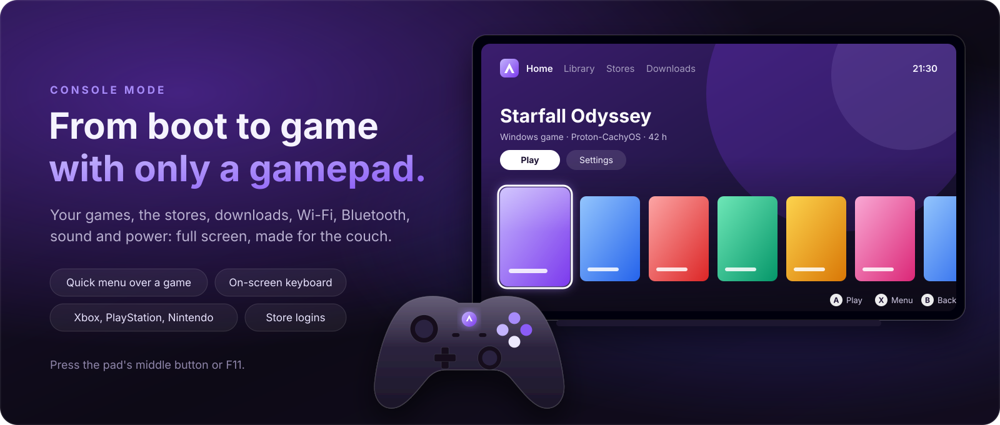
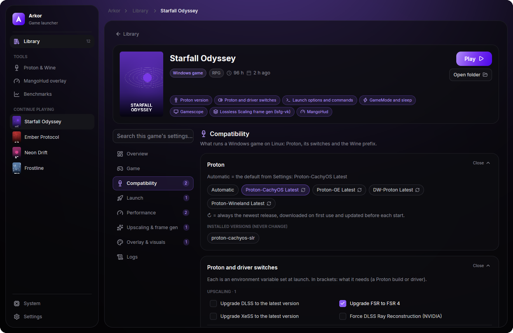
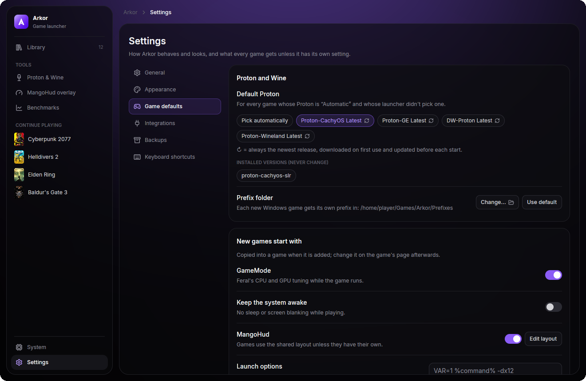

<p align="center">
  
</p>

<p align="center">
  <a href="https://github.com/WinTone01/arkor/releases/latest"></a>
  <a href="LICENSE"></a>
  
  
</p>

<h3 align="center">Steam, Epic, GOG, Amazon, emulators and your own games in one fast, native launcher.</h3>

<p align="center">
  The right Proton for every game, its own MangoHud, Gamescope and upscaler settings,<br>
  and a console mode that needs nothing but a gamepad. No config files to edit.
</p>

<p align="center">
  <a href="#install"><b>Install</b></a>&nbsp;&nbsp;·&nbsp;&nbsp;<a href="#features"><b>Features</b></a>&nbsp;&nbsp;·&nbsp;&nbsp;<a href="#console-mode"><b>Console mode</b></a>&nbsp;&nbsp;·&nbsp;&nbsp;<a href="#emulators"><b>Emulators</b></a>&nbsp;&nbsp;·&nbsp;&nbsp;<a href="#screenshots"><b>Screenshots</b></a>&nbsp;&nbsp;·&nbsp;&nbsp;<a href="#desktops"><b>Distributions</b></a>&nbsp;&nbsp;·&nbsp;&nbsp;<a href="#command-line"><b>Command line</b></a>
</p>

<br>

<p align="center">
  
</p>

<br>

<a id="install"></a>

##  Install

On **Arch Linux, CachyOS, Ubuntu 22.04 and newer, Linux Mint, Pop!_OS, Debian 12 and newer,
Fedora, Nobara, openSUSE** and most other distributions of the last years (x86_64, glibc 2.35
or newer), paste this into a terminal:

```bash
curl -fsSL https://raw.githubusercontent.com/WinTone01/arkor/master/packaging/install.sh | bash
```

It installs the latest [release](https://github.com/WinTone01/arkor/releases) into `~/.local`
with its menu entry and icon: no build, no root. On its first start Arkor sets up what games
need (umu-launcher, the Steam Linux Runtime, the anti-cheat runtimes and, if you have none,
Proton-CachyOS) and from then on **updates itself**. Missing system tools are installed with
your distribution's own package manager (pacman, apt, dnf or zypper). Store logins open in a
window of Arkor's own, which needs WebKitGTK 4.1; the install script tells you the package if it
is missing.

<details>
<summary><b>Build from source</b></summary>

<br>

As an Arch package (`arkor-git`; run it again to update):

```bash
git clone https://github.com/WinTone01/arkor.git /tmp/arkor && cd /tmp/arkor/packaging/arch && makepkg -si
```

Anywhere else, with Rust from [rustup.rs](https://rustup.rs):

```bash
git clone https://github.com/WinTone01/arkor.git && cd arkor
cargo build --release -p arkor -p arkor-login
./target/release/arkor
```

The window needs Vulkan, `libxkbcommon`, `libxcb`, `wayland` and `fontconfig`; the store
login window needs `webkit2gtk-4.1` (without it, logins open in your browser). At run time
Arkor uses `curl`, `tar` and `python`. Releases are built with `packaging/make-release.sh`,
in an Ubuntu 22.04 container (podman), so they run on older systems too.

</details>

<details>
<summary><b>Uninstall</b></summary>

<br>

```bash
curl -fsSL https://raw.githubusercontent.com/WinTone01/arkor/master/packaging/install.sh | bash -s -- --uninstall
```

This removes the program, its menu entry and its icon. Your games, Wine prefixes and settings
stay, so installing again picks up where you left off. Installed as a package? Use
`sudo pacman -R arkor-git`.

</details>

<a id="features"></a>

##  Features

<table>
  <tr>
    <td width="33%" valign="top">
      <br>
      <b>One library</b><br>
      <sub>Steam, Heroic, Lutris, Faugus, any Wine prefix and your own games together, with covers from SteamGridDB.</sub>
    </td>
    <td width="33%" valign="top">
      <br>
      <b>Proton on autopilot</b><br>
      <sub>umu-launcher in the Steam Linux Runtime. Proton-CachyOS, GE-Proton and more stay up to date; EasyAntiCheat and BattlEye included.</sub>
    </td>
    <td width="33%" valign="top">
      <br>
      <b>Four stores</b><br>
      <sub>Log in to Steam, Epic, GOG and Amazon inside Arkor and install what you own. Logins stay on your computer, encrypted.</sub>
    </td>
  </tr>
  <tr>
    <td valign="top">
      <br>
      <b>Steam, done properly</b><br>
      <sub>Each game's Proton and launch options are written into Steam, so Arkor's settings apply whichever Play you press.</sub>
    </td>
    <td valign="top">
      <br>
      <b>More frames</b><br>
      <sub>Gamescope, lsfg-vk, MAKO, AFMF, OptiScaler, DLSS Enabler and HelixSR, per game. Only what your GPU can use is shown.</sub>
    </td>
    <td valign="top">
      <br>
      <b>A real MangoHud editor</b><br>
      <sub>Live preview, presets, metrics, FPS limit and key bindings. One layout for every game, or a game's own.</sub>
    </td>
  </tr>
  <tr>
    <td valign="top">
      <br>
      <b>Better pictures</b><br>
      <sub>vkBasalt, ReShade, HDR and one-click switches: Wayland, NTSYNC, WOW64, Reflex, Anti-Lag 2.</sub>
    </td>
    <td valign="top">
      <br>
      <b>"Why did it not start?"</b><br>
      <sub>Arkor reads the log, the prefix and your system, says why in plain words and fixes it with one press.</sub>
    </td>
    <td valign="top">
      <br>
      <b>Saves kept safe</b><br>
      <sub>A copy of any game's saves after every session, found through Ludusavi, plus Epic and GOG cloud saves synced around it.</sub>
    </td>
  </tr>
  <tr>
    <td valign="top">
      <br>
      <b>Downloads that run themselves</b><br>
      <sub>One queue with pause and resume. Missing system tools install from the repositories with a progress bar.</sub>
    </td>
    <td valign="top">
      <br>
      <b>Everything else a game needs</b><br>
      <sub>Steam-style launch options, commands before and after, winecfg, winetricks, logs, benchmarks, backups, Discord status.</sub>
    </td>
    <td valign="top">
      <br>
      <b>Mods <sup>experimental</sup></b><br>
      <sub>Install, switch and order mods, FOMOD choices and Nexus Mods downloads, through <a href="https://github.com/ChrisDKN/Amethyst-Mod-Manager">Amethyst Mod Manager</a>.</sub>
    </td>
  </tr>
  <tr>
    <td valign="top">
      <br>
      <b>Emulators</b><br>
      <sub>Your ROMs from 30 consoles and computers in the same library, with box art and RetroAchievements. RetroArch, DuckStation, PCSX2, Dolphin and more are installed when a game first starts.</sub>
    </td>
    <td valign="top">
      <br>
      <b>Clips</b><br>
      <sub>The last moments of a game are kept in memory (GPU Screen Recorder); save them from the gamepad's middle button or a key.</sub>
    </td>
    <td valign="top">
      <br>
      <b>Any distribution</b><br>
      <sub>Arch, Ubuntu, Debian, Fedora, openSUSE and their families, with each one's own package manager.</sub>
    </td>
  </tr>
</table>

<p align="center"><sub>Dark or light, any accent colour, glass styles, animated backgrounds or your own picture · English and Turkish · Arkor updates itself.</sub></p>

**Also:** a list view, ready-made shelves (favourites, never played, a store, a genre) and
picking several games at once (Ctrl/Shift+click, Ctrl+A) · each game's description, genres,
age ratings, screenshots and trailers (Steam's store, VNDB, or IGDB with your own key), your
rating and status · **Statistics**: a year in review, charts and the play journal · the
graphics card a game renders on (laptops with two) · DXVK and VKD3D-Proton versions per game
· UMU-Proton, Proton-EM and Proton-Sarek · downloads that wait offline, on metered
connections or outside chosen hours · **Ctrl+K** command palette, **Ctrl +/−/0** text size ·
`arkor://launch/<id>` links (and Heroic's) · Arkor's games in Sunshine for Moonlight ·
Bottles' programs, and favourites, categories and play time carried over from Heroic,
Lutris and Faugus · Steam friends online in the sidebar (with Steam control on) · GOG play
time and achievements on the game page · Epic's overlay per game.

**Settings anyone can find:** a game's settings are grouped by what you want, not by the
tool that does it: *Smoother & faster* (upscaling, frame generation, input delay, stutters),
*Picture*, *Performance overlay*, *Compatibility* (Proton, crash fixes, graphics card,
gamepads). Each area opens on cards that say what its categories are for, and every switch
says in a sentence what it does. Console mode uses the same areas and explanations. Also:
MangoHud can report another graphics card, MAKO's GPU headroom and HDR brightness, ReShade's
menu key, renaming benchmark runs, the newest fakenvapi with OptiScaler, and DLSS-NR's
ReShade routes and 32-bit package.

<a id="console-mode"></a>

##  Console mode

<p align="center">
  
</p>

Everything Arkor does, full screen and from a gamepad: the library and the stores with their
logins, downloads, Proton builds, disks, **Wi-Fi, Bluetooth, sound, screens and power**. Where
something has to be typed, an on-screen keyboard comes up. During a game the pad's middle
button opens a **quick menu** at its side: volume, the performance overlay, a frame limit, a
screenshot, a clip of the last moments, or closing the game. At rest Arkor shows your games and the time, and keeps the
computer awake while the pad is in use.

Press the pad's middle button or <kbd>F11</kbd>, or let Arkor start in console mode with the
computer.

<a id="emulators"></a>

##  Emulators

**Library → Add game → Emulator games** adds every game in a folder of ROMs: one folder per
system (as EmuDeck and RetroDECK keep them, `~/ROMs/snes`, `~/ROMs/psx`…) or any folder, where
Arkor tells the system by the file and its contents. Discs of one game become one entry; a
single file can also be added by hand. The games then play like any other: MangoHud,
Gamescope, play time, clips and console mode's quick menu all work.

The first start of a game gets its emulator: Arkor downloads the project's own Linux build
(AppImages are unpacked, so FUSE is not needed), else installs it from Flathub for you only,
else from your distribution; a system library it lacks is installed first. An emulator you
already have is used as it is. RetroArch's cores come from the libretro buildbot, checked
before use. Each game can pick another emulator.

**Tools → Emulators** in the sidebar holds the rest:

- **Open** an emulator without a game, to set its controls and graphics up (in console mode:
  A on its line).
- **Options** per emulator: full screen, vertical sync, FPS, graphics driver…; the **version**
  games use (the three newest stay side by side) and installing an older one.
- **ROM folders** you added are read again at start and every few minutes: new games join
  the library by themselves, a game you removed stays out.
- **Covers**: libretro's box art by each ROM's name, or LaunchBox's box of the game's region
  (its games database, about 100 MB once a week, when you switch it on).
- **RetroAchievements**: sign in with your username and Web API key (kept encrypted) to see
  each game's achievements on its page (the count in console mode); type your password once
  to sign RetroArch, PCSX2, PPSSPP and Dolphin in (it is not kept).
- **An emulator of your own**: any program, its arguments (`{rom}` for the game) and the
  systems it plays.
- PlayStation 5 games through **AnyPS5** (experimental): it converts a decrypted
  `eboot.bin` once into a program of this computer.

Arkor does not download games or BIOS files. Systems that need a BIOS (PlayStation 1 and 2,
Sega CD, Dreamcast…) find yours in **Tools → Emulators → BIOS folder**, recognised by
their contents whatever their names.

<details>
<summary><b>Systems and their emulators</b> (the first one is used unless you choose)</summary>

| System | Emulators | BIOS |
| --- | --- | --- |
| Nintendo Entertainment System | RetroArch (Nestopia), RetroArch (Mesen) |  |
| Super Nintendo | RetroArch (Snes9x), RetroArch (bsnes) |  |
| Nintendo 64 | RetroArch (Mupen64Plus-Next), Gopher64 |  |
| Game Boy | RetroArch (Gambatte), RetroArch (mGBA), mGBA |  |
| Game Boy Color | RetroArch (Gambatte), RetroArch (mGBA), mGBA |  |
| Game Boy Advance | RetroArch (mGBA), mGBA |  |
| Nintendo DS | RetroArch (melonDS DS), melonDS |  |
| GameCube | Dolphin |  |
| Wii | Dolphin |  |
| Master System | RetroArch (Genesis Plus GX) |  |
| Mega Drive / Genesis | RetroArch (Genesis Plus GX) |  |
| Game Gear | RetroArch (Genesis Plus GX) |  |
| Mega-CD / Sega CD | RetroArch (Genesis Plus GX) | yes |
| PC Engine / TurboGrafx-16 | RetroArch (Beetle PCE Fast) |  |
| PlayStation | DuckStation, RetroArch (SwanStation) | yes |
| PlayStation Portable | PPSSPP, RetroArch (PPSSPP) |  |
| MS-DOS | DOSBox Staging |  |
| ScummVM adventures | ScummVM |  |
| PlayStation 2 | PCSX2 | yes |
| Nintendo 3DS | Azahar |  |
| Arcade | MAME |  |
| Wii U | Cemu (experimental) |  |
| PlayStation 3 | RPCS3 (experimental) |  |
| Xbox | xemu (experimental) |  |
| PlayStation 4 | shadPS4 (experimental) |  |
| PlayStation 5 | AnyPS5 (experimental) |  |
| Dreamcast | Flycast, RetroArch (Flycast) |  |
| PlayStation Vita | Vita3K (experimental) |  |
| Nintendo Switch | Ryujinx (experimental) |  |
| DOOM | UZDoom, GZDoom |  |

</details>

<a id="screenshots"></a>

##  Screenshots

<table>
  <tr>
    <td width="50%"><br><sub><b>A game's page</b>: quick switches and how it starts</sub></td>
    <td width="50%"><br><sub><b>Compatibility</b>: always-newest Proton builds and one-click switches</sub></td>
  </tr>
  <tr>
    <td width="50%"><br><sub><b>MangoHud editor</b>: live preview, presets and tabs</sub></td>
    <td width="50%"><br><sub><b>Game defaults</b>: one Proton for all, what new games start with</sub></td>
  </tr>
</table>

<sub>Cover art from <a href="https://www.steamgriddb.com">SteamGridDB</a>; the games and their art belong to their publishers.</sub>

<a id="first-steps"></a>

##  First steps

<table>
  <tr>
    <td width="56" align="center"></td>
    <td><b>Open Arkor.</b> The first start installs what games need; the sidebar shows the progress.</td>
  </tr>
  <tr>
    <td align="center"></td>
    <td><b>Add your games.</b> <b>Library → Add game</b> picks up games Arkor found on your computer, the games in a ROM folder, or adds one by hand; <b>Stores</b> installs what you own.</td>
  </tr>
  <tr>
    <td align="center"></td>
    <td><b>Play.</b> A game's page holds its settings; every switch says in one line what it does.</td>
  </tr>
  <tr>
    <td align="center"></td>
    <td><b>Set your defaults.</b> <b>Settings → Game defaults</b> chooses the Proton for every game and what new games start with.</td>
  </tr>
</table>

A game that does not start: **Logs → Why did it not start?** on its page, or **Why?** in
console mode. Steam games still start from Steam, with Arkor's settings written into it.

<a id="desktops"></a>

##  Distributions and desktops

The same release runs on every x86_64 distribution with glibc 2.35 or newer, and installs the
tools games need with the distribution's own package manager:

| Distribution | Install&nbsp;script | Notes |
| --- | --- | --- |
| **Arch Linux**, **CachyOS**, EndeavourOS, Manjaro |  | Made and played on here; also an Arch package (`arkor-git`) |
| **Ubuntu 22.04+**, **Debian 12+**, Linux Mint, Pop!_OS |  | Install checked on Ubuntu 22.04 and Debian 12; tools through `apt` |
| **Fedora**, Nobara |  | Install checked on Fedora 42; tools through `dnf` |
| **openSUSE** Tumbleweed |  | Install checked; tools through `zypper` |
| Others (NixOS, Void, Alpine…) |  | Alpine (musl) cannot run it; reports welcome |

Some tools are not packaged everywhere (umu-launcher on Debian, GPU Screen Recorder outside
Arch…): Arkor says so, and downloads what games need itself. Emulators work the same
everywhere: their downloads need no FUSE, a library one expects from the system (JACK, for
RetroArch) is installed with the package manager, and the rest come from Flathub (when
Flatpak is installed) or the distribution. Downloading and starting them was checked in
Debian 12, Fedora 42 and openSUSE Tumbleweed containers.

Arkor's window runs on any Linux desktop. Console mode also has to bring itself over a
running game, which every desktop allows in its own way:

| Desktop | Console&nbsp;mode | Notes |
| --- | --- | --- |
| **KDE Plasma** |  | Made and tested here |
| **Hyprland**, **Sway**, **niri** |  | Uses `hyprctl`, `swaymsg`, `niri msg`; not yet tested on real setups |
| **GNOME** |  | The middle button cannot bring Arkor over a game yet |
| **Others** (XFCE, Cinnamon, X11…) |  | Reports welcome |

<table>
  <tr>
    <td width="56" align="center"></td>
    <td>
      <b>Something different on your desktop?</b> <b>System → Copy diagnostics</b> (or <code>arkor system</code>)
      copies a report of your desktop and what its windows answered Arkor. Paste it into an
      <a href="https://github.com/WinTone01/arkor/issues/new/choose">issue</a>; it holds no names, logins or files of yours.
    </td>
  </tr>
</table>

<a id="command-line"></a>

##  Command line

| Command | What it does |
| --- | --- |
| `arkor` | Opens the window (`--console` in console mode, `--tray` in the system tray) |
| `arkor open <page or game>` | Opens a page, e.g. `arkor open local:starfall-odyssey#overlay` |
| `arkor list` · `arkor detect` | The library · games found in other launchers |
| `arkor add <exe> [--name N] [--linux]` | Adds a game by hand |
| `arkor launch <id>` | Starts a game with its settings |
| `arkor run <id> -- <command>` | Runs any command with a game's settings |
| `arkor tool <id> winecfg \| winetricks \| run <file>` | Prefix tools |
| `arkor proton installed \| list \| install` | Proton builds |
| `arkor trouble <id>` | Why a game did not start, and what helps |
| `arkor saves sync \| list \| restore \| places \| backup <id>` | Cloud saves, save backups and their copies |
| `arkor clip` | Saves a clip of the running game (bind it to a key) |
| `arkor url <arkor://… \| heroic://…>` | Follows a link: starts a game or opens a page |
| `arkor friends` · `arkor steam control on\|off` | Steam friends online · Arkor's control of Steam |
| `arkor achievements gog:<id>` | A GOG game's play time and achievements |
| `arkor info <id>` | What is known about a game (description, genres, age ratings) |
| `arkor dxvk [install \| remove <dxvk\|vkd3d> [version]]` | DXVK / VKD3D-Proton versions games can use |
| `arkor roms [--add] [folder…]` | Games in ROM folders (the usual ones without a folder); `--add` adds them |
| `arkor emulators [install \| remove \| open <id> \| core <core> \| bios \| launchbox]` | Emulators: what is installed, getting and opening them, BIOS status, LaunchBox |
| `arkor achievements [login <user> \| logout \| sign-in-emulators \| <id>]` | RetroAchievements of emulator games |
| `arkor nxm <link>` | Installs a mod from Nexus Mods' "Mod Manager Download" |
| `arkor backup create \| restore <file>` | Backs up or restores Arkor's data |
| `arkor system` | A report of the computer, the desktop and Arkor's tools |
| `arkor update [--check]` | Updates Arkor |

`arkor help` lists everything. In the window: <kbd>Ctrl</kbd>+<kbd>F</kbd> search,
<kbd>Ctrl</kbd>+<kbd>Enter</kbd> play, <kbd>Esc</kbd> back, <kbd>F11</kbd> console mode.

<a id="files"></a>

##  Where things are

| What | Where |
| --- | --- |
| Settings, library, game profiles | `~/.config/arkor/` |
| Launch logs, download queue | `~/.local/state/arkor/` |
| Runtimes, downloaded tools, store logins (encrypted) | `~/.local/share/arkor/` |
| Copies of saves | `~/.local/share/arkor/saves/` |
| Emulators, RetroArch's cores, the BIOS folder | `~/.local/share/arkor/emulators/` (RetroArch's settings and saves in `home/retroarch/`) |
| Mods (Amethyst's) | `~/Games/Amethyst/`, its settings in `~/.config/AmethystModManager/` |
| Games from stores · Wine prefixes | `~/Games/Arkor/Games/` · `~/Games/Arkor/Prefixes/` (changeable) |
| Proton builds | `~/.local/share/Steam/compatibilitytools.d/` (shared with Steam) |

<a id="credits"></a>

##  Credits

Arkor stands on the shoulders of great Linux gaming projects:
[umu-launcher](https://github.com/Open-Wine-Components/umu-launcher) and
[Faugus Launcher](https://github.com/Faugus/faugus-launcher) (whose umu build and anti-cheat
packages Arkor uses), [Heroic Games Launcher](https://github.com/Heroic-Games-Launcher/HeroicGamesLauncher)
(whose way of working with the stores Arkor follows), the mod manager [Amethyst](https://github.com/ChrisDKN/Amethyst-Mod-Manager) (which installs
and places mods for Arkor), [Ludusavi's manifest](https://github.com/mtkennerly/ludusavi-manifest)
(which tells where games keep their saves, from [PCGamingWiki](https://www.pcgamingwiki.com)),
[Irori](https://github.com/irori-app/irori) (whose systems catalog, emulator definitions, BIOS
index, ROM scanning, LaunchBox and RetroAchievements code Arkor's emulator support is built on),
[LaunchBox Games Database](https://gamesdb.launchbox-app.com), [libretro-thumbnails](https://github.com/libretro-thumbnails),
[RetroAchievements](https://retroachievements.org), [AnyPS5](https://github.com/boykopovar/AnyPS5), [RetroArch](https://www.retroarch.com)
and the libretro buildbot, the emulators themselves, and the store helpers
[legendary](https://github.com/legendary-gl/legendary), [gogdl](https://github.com/Heroic-Games-Launcher/heroic-gogdl)
and [nile](https://github.com/imLinguin/nile),
[GOverlay](https://github.com/benjamimgois/goverlay), [MangoHud](https://github.com/flightlessmango/MangoHud),
[GE-Proton](https://github.com/GloriousEggroll/proton-ge-custom),
[Proton-CachyOS](https://github.com/CachyOS/proton-cachyos),
[lsfg-vk](https://github.com/PancakeTAS/lsfg-vk),
[OptiScaler](https://github.com/optiscaler/OptiScaler) and
[SteamGridDB](https://www.steamgriddb.com). The window is built with
[gpui-kit](https://crates.io/crates/gpui-kit); icons are [Lucide](https://lucide.dev)
(ISC license), the font is [Inter](https://rsms.me/inter/).

<a id="license"></a>

##  License

Arkor is free software under the [GNU General Public License v3.0 or later](LICENSE).
