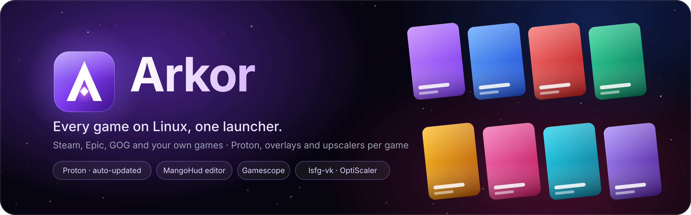
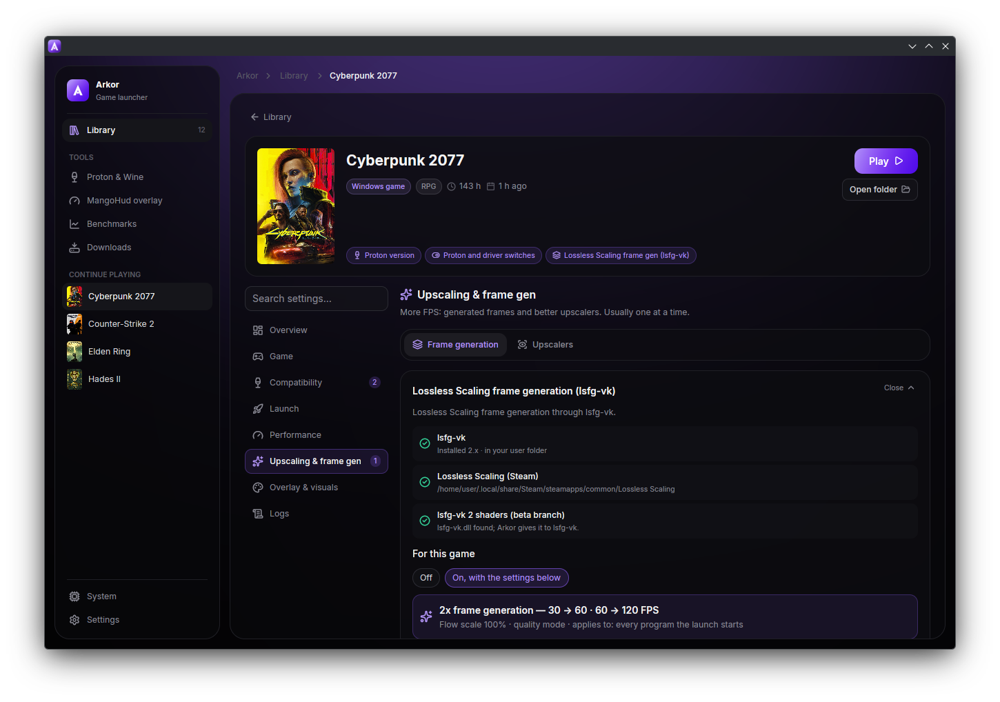
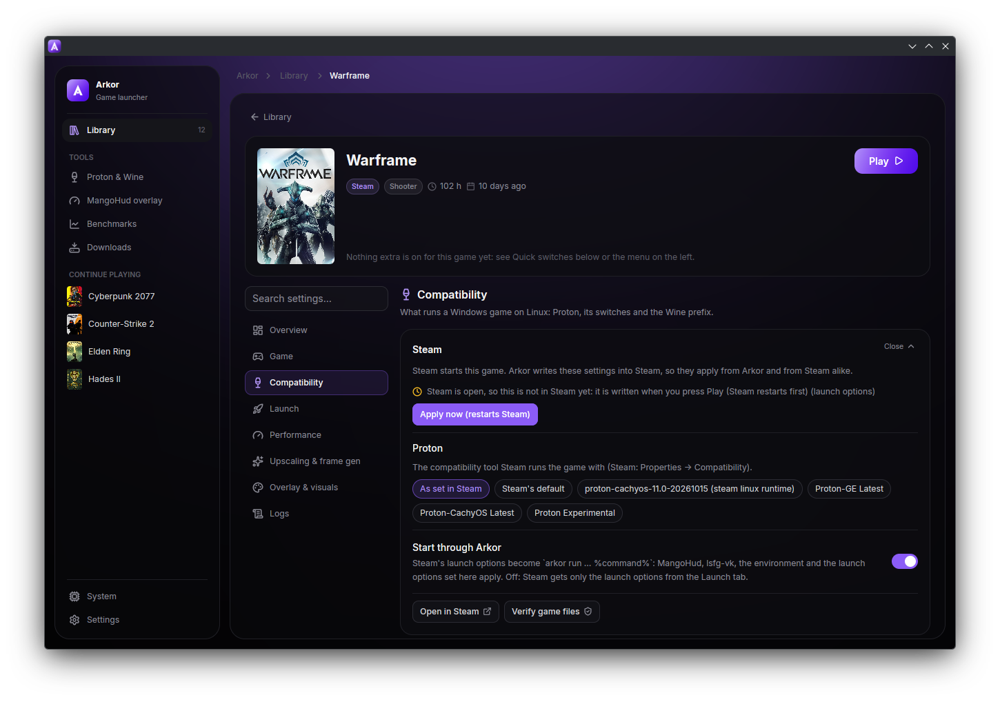
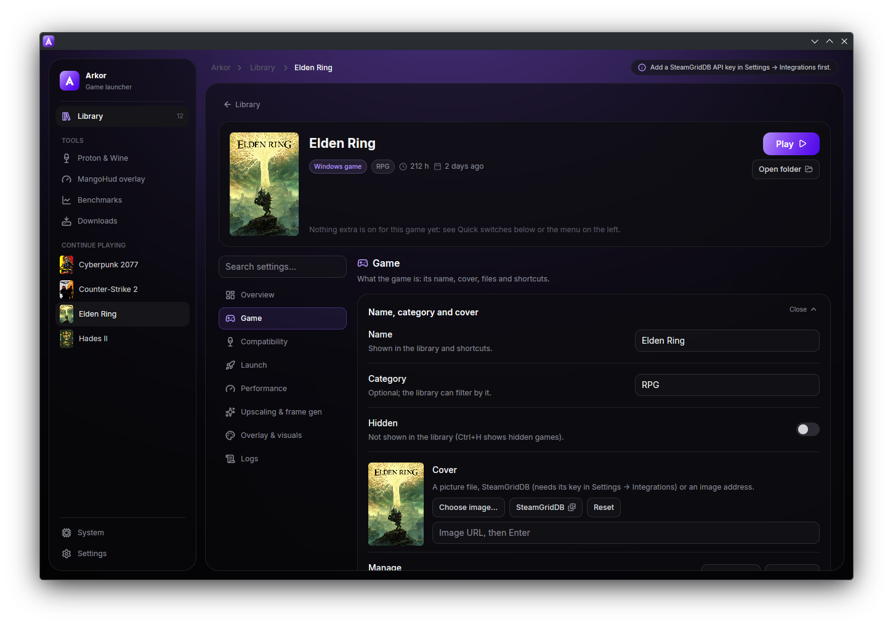
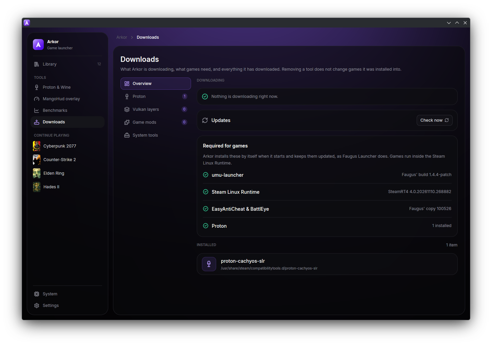

<p align="center">
  
</p>

<p align="center">
  <a href="LICENSE"></a>
  
  
  
</p>

<p align="center">
  <b>Arkor</b> is a fast, native game launcher for Linux. Steam, Epic, GOG and your own
  Windows and Linux games in one library, started with the right Proton, each with its own
  MangoHud, Gamescope, frame generation and upscaler settings — no config files to edit.
</p>

<a id="install"></a>

##  Install in one command

> [!TIP]
> **Arch Linux, CachyOS, EndeavourOS, Manjaro and other up-to-date distributions (x86_64,
> glibc 2.44 or newer)** — paste this into a terminal:
>
> ```bash
> curl -fsSL https://raw.githubusercontent.com/WinTone01/arkor/master/packaging/install.sh | bash
> ```
>
> It downloads the latest release from [Releases](https://github.com/WinTone01/arkor/releases)
> (no build, no root) and installs it into `~/.local` with its app-menu entry and icon.
> Arkor then updates itself: **Settings → General → Arkor updates**, or the note in the
> sidebar when a new version is out.

**Uninstall** — removes the program, its menu entry and icon (your settings, games and
Wine prefixes stay):

```bash
curl -fsSL https://raw.githubusercontent.com/WinTone01/arkor/master/packaging/install.sh | bash -s -- --uninstall
```

On the first start Arkor sets itself up: it downloads umu-launcher, the Steam Linux Runtime,
the EasyAntiCheat and BattlEye runtimes and, if you have no Proton yet, Proton-CachyOS.

<details>
<summary><b>Build from source</b> (an Arch package, or distributions with an older glibc)</summary>

<br>

On Arch-based systems this builds Arkor as a pacman package (`arkor-git`); update it by running
the command again (a package-manager install does not update itself):

```bash
git clone https://github.com/WinTone01/arkor.git /tmp/arkor && cd /tmp/arkor/packaging/arch && makepkg -si
```

On other distributions, install Rust from [rustup.rs](https://rustup.rs) or your package manager, then:

```bash
git clone https://github.com/WinTone01/arkor.git && cd arkor
cargo build --release -p arkor
./target/release/arkor
```

The window needs Vulkan and `libxkbcommon`, `libxcb`, `wayland`, `fontconfig`. At run time
Arkor uses `curl`, `tar` and `python` (for umu-run).

</details>

**Optional tools** — Arkor works with what you have and **Downloads → System tools** shows what is
missing: `mangohud`, `gamescope`, `winetricks`, `steam`, `legendary` (or
Heroic) for Epic games, `vkbasalt`.

<a id="screenshots"></a>

##  Screenshots

<p align="center">
  
</p>

<table>
  <tr>
    <td width="50%"><br><sub><b>A game's page</b> — quick switches and how it starts</sub></td>
    <td width="50%"><br><sub><b>Upscaling &amp; frame gen</b> — lsfg-vk, MAKO, OptiScaler and more, with what is installed</sub></td>
  </tr>
  <tr>
    <td width="50%"><br><sub><b>Compatibility</b> — always-newest Proton builds and one-click switches</sub></td>
    <td width="50%"><br><sub><b>Steam games</b> — Proton and Arkor's settings written into Steam</sub></td>
  </tr>
  <tr>
    <td width="50%"><br><sub><b>Covers</b> — pick a picture or an animated one from SteamGridDB</sub></td>
    <td width="50%"><br><sub><b>Downloads</b> — a queue with pause and resume, updates and required parts</sub></td>
  </tr>
  <tr>
    <td width="50%"><br><sub><b>MangoHud editor</b> — live preview, presets and tabs</sub></td>
    <td width="50%"><br><sub><b>Game defaults</b> — one Proton for all, what new games start with</sub></td>
  </tr>
</table>

<sub>Cover art from <a href="https://www.steamgriddb.com">SteamGridDB</a>; the games and their art belong to their publishers.</sub>

<a id="features"></a>

##  Features

<table>
  <tr>
    <td width="50%" valign="top">
      <br>
      <b>One library</b><br>
      Finds games already installed in <b>Steam</b>, <b>Heroic</b> (Epic, GOG, sideloaded),
      <b>Lutris</b> and <b>Faugus</b>, imports games from any Wine prefix, or adds a game by
      hand. Covers from the store or picked from <b>SteamGridDB</b> (animated ones too, and
      set by themselves for new games), categories, search, hidden games, play time and a
      gamepad-friendly <b>big-screen mode</b>.
    </td>
    <td width="50%" valign="top">
      <br>
      <b>Proton that takes care of itself</b><br>
      Runs Windows games through <b>umu-launcher</b>. Proton-CachyOS, GE-Proton, DW-Proton and
      Wineland come as <b>Latest</b> builds that keep themselves up to date, next to any fixed
      version you download. umu, the <b>Steam Linux Runtime</b>, <b>EasyAntiCheat</b> and
      <b>BattlEye</b> are installed by Arkor itself.
    </td>
  </tr>
  <tr>
    <td valign="top">
      <br>
      <b>A real MangoHud editor</b><br>
      A live preview with presets, then layout, metrics, look, FPS limit and VSync, logging
      and key bindings in clear tabs. One shared layout for every game, or a game's own.
    </td>
    <td valign="top">
      <br>
      <b>More frames, per game</b><br>
      <b>Gamescope</b>, <b>lsfg-vk</b> (Lossless Scaling frame generation), <b>MAKO</b>,
      <b>AFMF</b>, <b>OptiScaler</b> (e.g. FSR 4 in DLSS games), <b>DLSS Enabler</b>,
      newer <b>DLSS</b> files, <b>HelixSR</b> and <b>DLSS-NR</b> for AMD cards.
    </td>
  </tr>
  <tr>
    <td valign="top">
      <br>
      <b>Better pictures</b><br>
      <b>vkBasalt</b>, <b>ReShade</b>, vkSumi colour grading, HDR, and one-click Proton
      and driver switches: Wayland, NTSYNC, WOW64, Reflex, Anti-Lag 2, DLSS/FSR/XeSS upgrades.
    </td>
    <td valign="top">
      <br>
      <b>Everything a game needs</b><br>
      Launch options in Steam style (<code>VAR=1 %command%</code>), commands before and after,
      a second program next to the game, winecfg and winetricks, protonfixes, clear launch
      logs, benchmarks from MangoHud logs, backups and Discord status.
    </td>
  </tr>
  <tr>
    <td valign="top">
      <br>
      <b>Steam games, done properly</b><br>
      Steam still starts them, and Arkor writes its choices into Steam: the game's
      <b>Proton</b> and launch options that run it <b>through Arkor</b>, so MangoHud, frame
      generation and the environment apply whether you press Play in Arkor or in Steam.
    </td>
    <td valign="top">
      <br>
      <b>Downloads that run themselves</b><br>
      One queue with pause, resume and retry. What a game's settings need is fetched as soon
      as you switch it on; updates come daily, weekly, when a game starts or never. Missing
      system tools install from the repositories (or the AUR) with a progress bar.
    </td>
  </tr>
  <tr>
    <td colspan="2" valign="top">
      <br>
      <b>Looks the way you like</b><br>
      Dark or light, any accent colour, four glass styles, animated backgrounds or your own
      picture, adjustable text size; in English and Turkish.
    </td>
  </tr>
</table>

<a id="first-steps"></a>

##  First steps

1. **Open Arkor.** The first start installs what Windows games need; the sidebar shows it.
2. **Library → Add game.** Pick a game Arkor found on your computer, or add an `.exe`
   (or a Linux game) by hand.
3. **Play.** A game's page has its settings: *Overview* holds the most used switches, and
   every feature says in one line what it does.
4. **Settings → Game defaults** sets the Proton for all games and what new games start with.

Steam games keep starting from Steam. Arkor sets their Proton and launch options in Steam
for you (**Compatibility → Steam** on the game's page), so its settings apply from either
launcher.

<a id="command-line"></a>

##  Command line

Everything in the window is also scriptable:

| Command | What it does |
| --- | --- |
| `arkor` | Opens the window (`--tray` starts in the system tray) |
| `arkor open <page or game>` | Opens a page, e.g. `arkor open local:starfall-odyssey#overlay` |
| `arkor list` · `arkor detect` | Prints the library · games found in other launchers |
| `arkor add <exe> [--name N] [--linux]` | Adds a game by hand |
| `arkor launch <id>` | Starts a game with its settings |
| `arkor run <id> -- <command>` | Runs any command with a game's settings |
| `arkor tool <id> winecfg \| winetricks \| run <file>` | Prefix tools |
| `arkor proton installed \| list \| install` | Proton builds |
| `arkor backup create \| restore <file>` | Backs up or restores Arkor's data |

Run `arkor help` for the full list.

**Keyboard:** <kbd>Ctrl</kbd>+<kbd>F</kbd> search · <kbd>Ctrl</kbd>+<kbd>Enter</kbd> play ·
<kbd>Ctrl</kbd>+<kbd>Tab</kbd> next section · <kbd>Esc</kbd> back ·
<kbd>F11</kbd> big-screen mode (gamepad).

<a id="files"></a>

##  Where things are

| | |
| --- | --- |
| Settings, library, game profiles | `~/.config/arkor/` |
| Launch logs | `~/.local/state/arkor/logs/` |
| umu-run, anti-cheat runtimes, downloaded tools | `~/.local/share/arkor/` |
| Download queue | `~/.local/state/arkor/queue.toml` |
| Proton builds | `~/.local/share/Steam/compatibilitytools.d/` (shared with Steam and Faugus) |
| Wine prefixes of new games | `~/Games/Arkor/Prefixes/` (changeable in Settings) |

<a id="credits"></a>

##  Credits

Arkor stands on the shoulders of great Linux gaming projects:
[umu-launcher](https://github.com/Open-Wine-Components/umu-launcher) and
[Faugus Launcher](https://github.com/Faugus/faugus-launcher) (whose umu build and anti-cheat
packages Arkor uses), [Heroic Games Launcher](https://github.com/Heroic-Games-Launcher/HeroicGamesLauncher),
[GOverlay](https://github.com/benjamimgois/goverlay), [MangoHud](https://github.com/flightlessmango/MangoHud),
[GE-Proton](https://github.com/GloriousEggroll/proton-ge-custom),
[Proton-CachyOS](https://github.com/CachyOS/proton-cachyos) and
[OptiScaler](https://github.com/optiscaler/OptiScaler). The window is built with
[gpui-kit](https://crates.io/crates/gpui-kit); icons are [Lucide](https://lucide.dev)
(ISC license), the font is [Inter](https://rsms.me/inter/).

<a id="license"></a>

##  License

Arkor is free software under the [GNU General Public License v3.0 or later](LICENSE).
