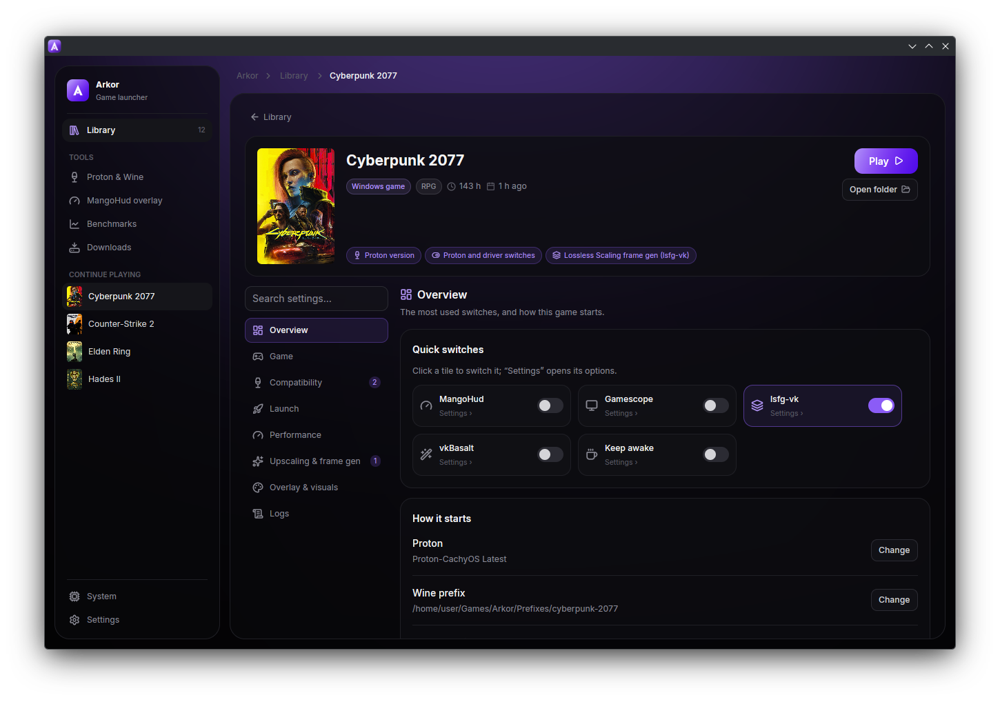
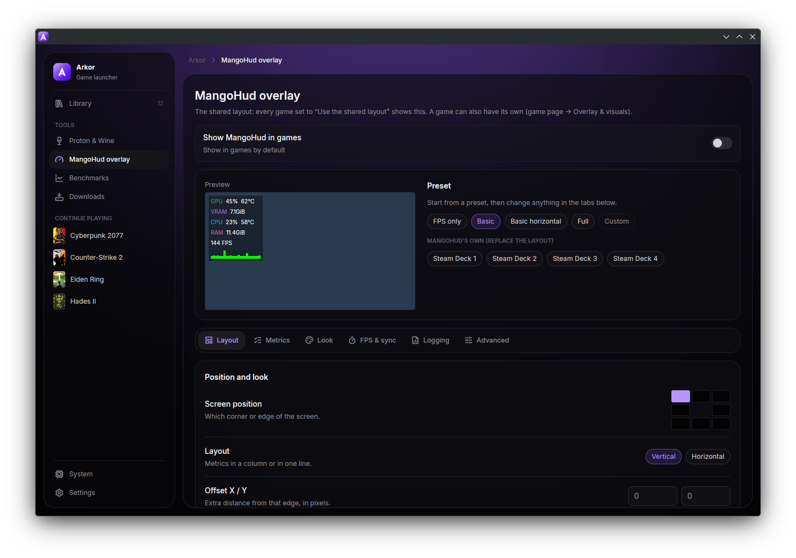

<p align="center">
  
</p>

<p align="center">
  <a href="https://github.com/WinTone01/arkor/releases/latest"></a>
  <a href="LICENSE"></a>
  
  
</p>

<h3 align="center">Steam, Epic, GOG, Amazon and your own games in one fast, native launcher.</h3>

<p align="center">
  The right Proton for every game, its own MangoHud, Gamescope and upscaler settings,<br>
  and a console mode that needs nothing but a gamepad. No config files to edit.
</p>

<p align="center">
  <a href="#install"><b>Install</b></a>&nbsp;&nbsp;·&nbsp;&nbsp;<a href="#features"><b>Features</b></a>&nbsp;&nbsp;·&nbsp;&nbsp;<a href="#console-mode"><b>Console mode</b></a>&nbsp;&nbsp;·&nbsp;&nbsp;<a href="#screenshots"><b>Screenshots</b></a>&nbsp;&nbsp;·&nbsp;&nbsp;<a href="#desktops"><b>Desktops</b></a>&nbsp;&nbsp;·&nbsp;&nbsp;<a href="#command-line"><b>Command line</b></a>
</p>

<br>

<p align="center">
  
</p>

<br>

<a id="install"></a>

##  Install

For **Arch Linux, CachyOS, EndeavourOS, Manjaro** and other up-to-date distributions (x86_64,
glibc 2.44 or newer), paste this into a terminal:

```bash
curl -fsSL https://raw.githubusercontent.com/WinTone01/arkor/master/packaging/install.sh | bash
```

It installs the latest [release](https://github.com/WinTone01/arkor/releases) into `~/.local`
with its menu entry and icon: no build, no root. On its first start Arkor sets up what games
need (umu-launcher, the Steam Linux Runtime, the anti-cheat runtimes and, if you have none,
Proton-CachyOS) and from then on **updates itself**.

<details>
<summary><b>Build from source</b></summary>

<br>

As an Arch package (`arkor-git`; run it again to update):

```bash
git clone https://github.com/WinTone01/arkor.git /tmp/arkor && cd /tmp/arkor/packaging/arch && makepkg -si
```

Anywhere else, with Rust from [rustup.rs](https://rustup.rs):

```bash
git clone https://github.com/WinTone01/arkor.git && cd arkor
cargo build --release -p arkor -p arkor-login
./target/release/arkor
```

The window needs Vulkan, `libxkbcommon`, `libxcb`, `wayland` and `fontconfig`; the store
login window needs `webkit2gtk-4.1` (without it, logins open in your browser). At run time
Arkor uses `curl`, `tar` and `python`.

</details>

<details>
<summary><b>Uninstall</b></summary>

<br>

```bash
curl -fsSL https://raw.githubusercontent.com/WinTone01/arkor/master/packaging/install.sh | bash -s -- --uninstall
```

This removes the program, its menu entry and its icon. Your games, Wine prefixes and settings
stay, so installing again picks up where you left off. Installed as a package? Use
`sudo pacman -R arkor-git`.

</details>

<a id="features"></a>

##  Features

<table>
  <tr>
    <td width="33%" valign="top">
      <br>
      <b>One library</b><br>
      <sub>Steam, Heroic, Lutris, Faugus, any Wine prefix and your own games together, with covers from SteamGridDB.</sub>
    </td>
    <td width="33%" valign="top">
      <br>
      <b>Proton on autopilot</b><br>
      <sub>umu-launcher in the Steam Linux Runtime. Proton-CachyOS, GE-Proton and more stay up to date; EasyAntiCheat and BattlEye included.</sub>
    </td>
    <td width="33%" valign="top">
      <br>
      <b>Four stores</b><br>
      <sub>Log in to Steam, Epic, GOG and Amazon inside Arkor and install what you own. Logins stay on your computer, encrypted.</sub>
    </td>
  </tr>
  <tr>
    <td valign="top">
      <br>
      <b>Steam, done properly</b><br>
      <sub>Each game's Proton and launch options are written into Steam, so Arkor's settings apply whichever Play you press.</sub>
    </td>
    <td valign="top">
      <br>
      <b>More frames</b><br>
      <sub>Gamescope, lsfg-vk, MAKO, AFMF, OptiScaler, DLSS Enabler and HelixSR, per game. Only what your GPU can use is shown.</sub>
    </td>
    <td valign="top">
      <br>
      <b>A real MangoHud editor</b><br>
      <sub>Live preview, presets, metrics, FPS limit and key bindings. One layout for every game, or a game's own.</sub>
    </td>
  </tr>
  <tr>
    <td valign="top">
      <br>
      <b>Better pictures</b><br>
      <sub>vkBasalt, ReShade, HDR and one-click switches: Wayland, NTSYNC, WOW64, Reflex, Anti-Lag 2.</sub>
    </td>
    <td valign="top">
      <br>
      <b>"Why did it not start?"</b><br>
      <sub>Arkor reads the log, the prefix and your system, says why in plain words and fixes it with one press.</sub>
    </td>
    <td valign="top">
      <br>
      <b>Saves kept safe</b><br>
      <sub>Epic and GOG cloud saves synced around every session, with a copy kept before anything is replaced.</sub>
    </td>
  </tr>
  <tr>
    <td valign="top">
      <br>
      <b>Downloads that run themselves</b><br>
      <sub>One queue with pause and resume. Missing system tools install from the repositories with a progress bar.</sub>
    </td>
    <td valign="top">
      <br>
      <b>Everything else a game needs</b><br>
      <sub>Steam-style launch options, commands before and after, winecfg, winetricks, logs, benchmarks, backups, Discord status.</sub>
    </td>
    <td valign="top">
      <br>
      <b>Looks the way you like</b><br>
      <sub>Dark or light, any accent colour, glass styles, animated backgrounds or your own picture. English and Turkish.</sub>
    </td>
  </tr>
</table>

<a id="console-mode"></a>

##  Console mode

<p align="center">
  
</p>

Everything Arkor does, full screen and from a gamepad: the library and the stores with their
logins, downloads, Proton builds, disks, **Wi-Fi, Bluetooth, sound, screens and power**. Where
something has to be typed, an on-screen keyboard comes up. During a game the pad's middle
button opens a **quick menu** at its side: volume, the performance overlay, a frame limit, a
screenshot, or closing the game. At rest Arkor shows your games and the time, and keeps the
computer awake while the pad is in use.

Press the pad's middle button or <kbd>F11</kbd>, or let Arkor start in console mode with the
computer.

<a id="screenshots"></a>

##  Screenshots

<table>
  <tr>
    <td width="50%"><br><sub><b>A game's page</b>: quick switches and how it starts</sub></td>
    <td width="50%"><br><sub><b>Compatibility</b>: always-newest Proton builds and one-click switches</sub></td>
  </tr>
  <tr>
    <td width="50%"><br><sub><b>MangoHud editor</b>: live preview, presets and tabs</sub></td>
    <td width="50%"><br><sub><b>Game defaults</b>: one Proton for all, what new games start with</sub></td>
  </tr>
</table>

<sub>Cover art from <a href="https://www.steamgriddb.com">SteamGridDB</a>; the games and their art belong to their publishers.</sub>

<a id="first-steps"></a>

##  First steps

<table>
  <tr>
    <td width="56" align="center"></td>
    <td><b>Open Arkor.</b> The first start installs what games need; the sidebar shows the progress.</td>
  </tr>
  <tr>
    <td align="center"></td>
    <td><b>Add your games.</b> <b>Library → Add game</b> picks up games Arkor found on your computer or adds one by hand; <b>Stores</b> installs what you own.</td>
  </tr>
  <tr>
    <td align="center"></td>
    <td><b>Play.</b> A game's page holds its settings; every switch says in one line what it does.</td>
  </tr>
  <tr>
    <td align="center"></td>
    <td><b>Set your defaults.</b> <b>Settings → Game defaults</b> chooses the Proton for every game and what new games start with.</td>
  </tr>
</table>

A game that does not start: **Logs → Why did it not start?** on its page, or **Why?** in
console mode. Steam games still start from Steam, with Arkor's settings written into it.

<a id="desktops"></a>

##  Desktops

Arkor's window runs on any Linux desktop. Console mode also has to bring itself over a
running game, which every desktop allows in its own way:

| Desktop | Console&nbsp;mode | Notes |
| --- | --- | --- |
| **KDE Plasma** |  | Made and tested here |
| **Hyprland**, **Sway**, **niri** |  | Uses `hyprctl`, `swaymsg`, `niri msg`; not yet tested on real setups |
| **GNOME** |  | The middle button cannot bring Arkor over a game yet |
| **Others** (XFCE, Cinnamon, X11…) |  | Reports welcome |

<table>
  <tr>
    <td width="56" align="center"></td>
    <td>
      <b>Something different on your desktop?</b> <b>System → Copy diagnostics</b> (or <code>arkor system</code>)
      copies a report of your desktop and what its windows answered Arkor. Paste it into an
      <a href="https://github.com/WinTone01/arkor/issues/new/choose">issue</a>; it holds no names, logins or files of yours.
    </td>
  </tr>
</table>

<a id="command-line"></a>

##  Command line

| Command | What it does |
| --- | --- |
| `arkor` | Opens the window (`--console` in console mode, `--tray` in the system tray) |
| `arkor open <page or game>` | Opens a page, e.g. `arkor open local:starfall-odyssey#overlay` |
| `arkor list` · `arkor detect` | The library · games found in other launchers |
| `arkor add <exe> [--name N] [--linux]` | Adds a game by hand |
| `arkor launch <id>` | Starts a game with its settings |
| `arkor run <id> -- <command>` | Runs any command with a game's settings |
| `arkor tool <id> winecfg \| winetricks \| run <file>` | Prefix tools |
| `arkor proton installed \| list \| install` | Proton builds |
| `arkor trouble <id>` | Why a game did not start, and what helps |
| `arkor saves sync \| list \| restore <id>` | Cloud saves and their copies |
| `arkor backup create \| restore <file>` | Backs up or restores Arkor's data |
| `arkor system` | A report of the computer, the desktop and Arkor's tools |
| `arkor update [--check]` | Updates Arkor |

`arkor help` lists everything. In the window: <kbd>Ctrl</kbd>+<kbd>F</kbd> search,
<kbd>Ctrl</kbd>+<kbd>Enter</kbd> play, <kbd>Esc</kbd> back, <kbd>F11</kbd> console mode.

<a id="files"></a>

##  Where things are

| What | Where |
| --- | --- |
| Settings, library, game profiles | `~/.config/arkor/` |
| Launch logs, download queue | `~/.local/state/arkor/` |
| Runtimes, downloaded tools, store logins (encrypted) | `~/.local/share/arkor/` |
| Copies of saves | `~/.local/share/arkor/saves/` |
| Games from stores · Wine prefixes | `~/Games/Arkor/Games/` · `~/Games/Arkor/Prefixes/` (changeable) |
| Proton builds | `~/.local/share/Steam/compatibilitytools.d/` (shared with Steam) |

<a id="credits"></a>

##  Credits

Arkor stands on the shoulders of great Linux gaming projects:
[umu-launcher](https://github.com/Open-Wine-Components/umu-launcher) and
[Faugus Launcher](https://github.com/Faugus/faugus-launcher) (whose umu build and anti-cheat
packages Arkor uses), [Heroic Games Launcher](https://github.com/Heroic-Games-Launcher/HeroicGamesLauncher)
(whose way of working with the stores Arkor follows) and the store helpers
[legendary](https://github.com/legendary-gl/legendary), [gogdl](https://github.com/Heroic-Games-Launcher/heroic-gogdl)
and [nile](https://github.com/imLinguin/nile),
[GOverlay](https://github.com/benjamimgois/goverlay), [MangoHud](https://github.com/flightlessmango/MangoHud),
[GE-Proton](https://github.com/GloriousEggroll/proton-ge-custom),
[Proton-CachyOS](https://github.com/CachyOS/proton-cachyos),
[lsfg-vk](https://github.com/PancakeTAS/lsfg-vk),
[OptiScaler](https://github.com/optiscaler/OptiScaler) and
[SteamGridDB](https://www.steamgriddb.com). The window is built with
[gpui-kit](https://crates.io/crates/gpui-kit); icons are [Lucide](https://lucide.dev)
(ISC license), the font is [Inter](https://rsms.me/inter/).

<a id="license"></a>

##  License

Arkor is free software under the [GNU General Public License v3.0 or later](LICENSE).
